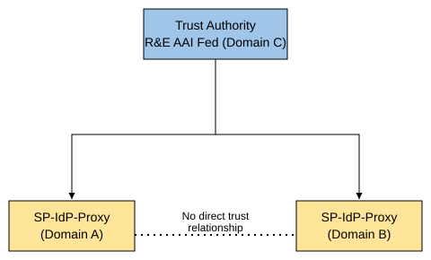
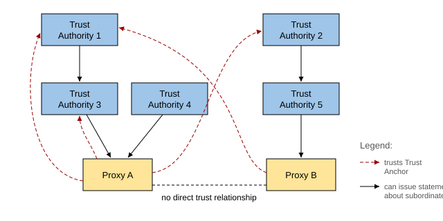
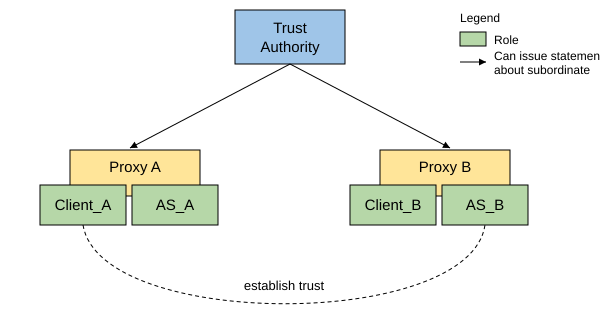
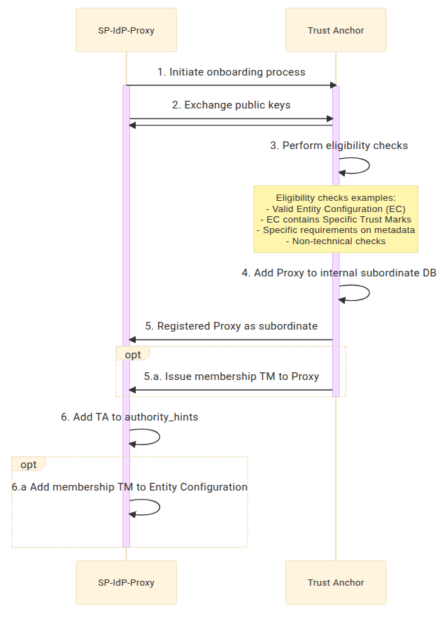
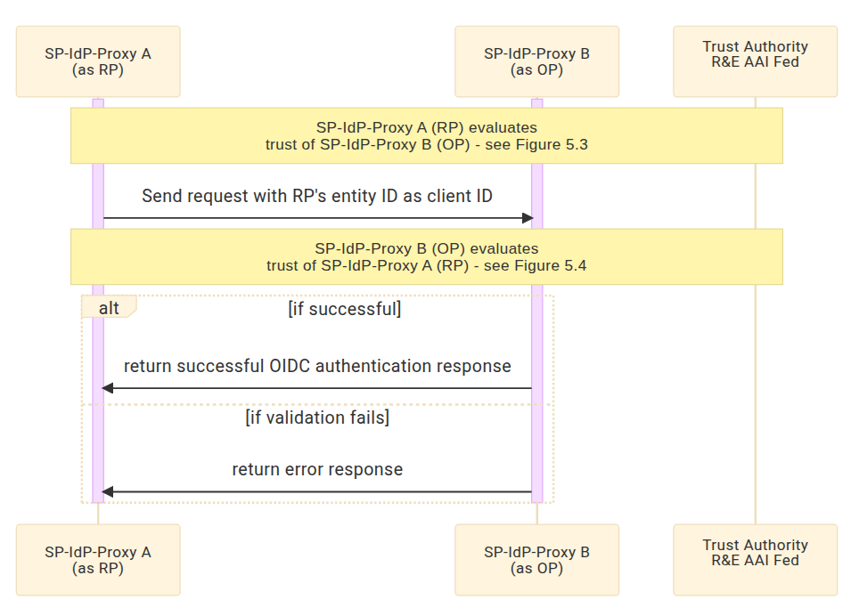
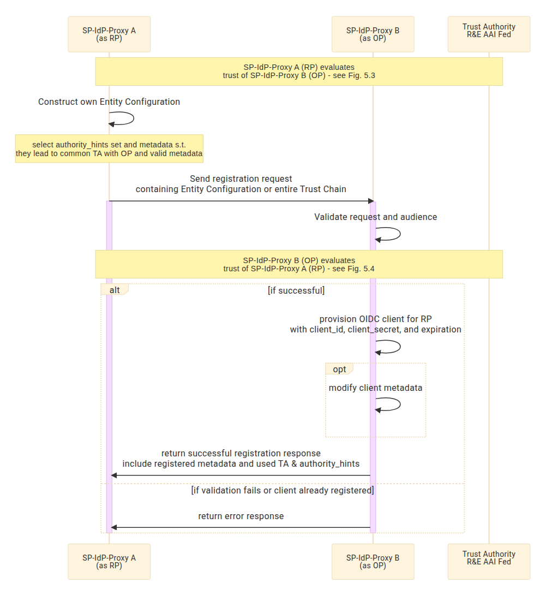

---
title:
  "Guidelines for Establishing Trust between AARC-compliant AAI services using
  OpenID Federation (AARC-G100)"
document-code: "AARC-G100"
publication-date: "2025-10-20"
author:
  - "Diana Gudu (ed)"
  - "Halil Adem"
  - "Federica Agostini"
  - "Valeria Ardizzione"
  - "Thomas Dack"
  - "Konstantinos Georgilakis"
  - "Marcus Hardt"
  - "Jens Jensen"
  - "Ivan Kanakarakis"
  - "Christos Kanellopoulos"
  - "Andreas Kozadinos"
  - "Nicolas Liampotis"
  - "Nick Mastoris"
  - "Jan Pavlíček"
  - "Mischa Sallé"
  - "Hannah Short"
  - "Michal Stava"
  - "Klaas Wierenga"
  - "Gabriel Zachmann"
doi: "10.5281/zenodo.17054048"
community: "Architecture Area"
# The text is the Google Docs source of 2026-10-12 with every suggestion
# accepted, so it is a revision of the version published under the DOI above.
status: "DRAFT"
keywords: ["AARC", "OpenID Federation", "trust", "proxy"]
abstract: |
  This specification provides guidance for enabling interaction and
  establishing trust among Proxies following the AARC Blueprint Architecture
  that implement OpenID Connect Providers (OP) and Relying Parties (RP), or
  OAuth 2.0 Authorization Servers (AS) and Resource Servers (RS) residing in
  distinct domains. These interactions are facilitated through trusted third
  parties referred to as Trust Authorities, which are entities issuing
  authoritative statements about entities that participate in an identity
  federation. The federation uses OpenID Federation. This document is intended
  for operators and implementers of AAI services and defines two trust
  profiles: G100.1 (Basic Trust Model), specifying the minimum requirements for
  establishing trust between proxies using OpenID Federation trust chains, and
  G100.2 (Fine-Grained Trust Model), which extends the basic model with
  policy-based trust through the use of Trust Marks and metadata policies.
bibliography: references.json
---

# Introduction {#sec-introduction}

This document provides normative guidance for enabling interaction and
establishing trust among Proxies following the AARC Blueprint Architecture
[@AARC-G045] that implement OpenID Connect Providers (OP) and Relying Parties
(RP), or OAuth 2.0 Authorization Servers (AS) and Resource Servers (RS) residing
in distinct domains. These interactions are facilitated through trusted third
parties referred to as Trust Authorities, which are entities issuing
authoritative statements about entities that participate in an identity
federation. This guideline assumes that the federation uses OpenID Federation
and it complements the [@AARC-I058] informational document. I058 explores
multiple approaches for establishing trust, and selects a single approach to
focus on, the recommended approach _6. Federation Entity Discovery_.

The document is a baseline about what is required to establish trust between
proxies. It is a profile for using OpenID Federation with AARC-compliant
entities traditionally called SP-IdP Proxies, though in an OIDC-only deployment,
more accurately called RP-OP-Proxies. As such it describes the basic behaviour
(minimum requirements) that Proxies need to comply with in order to enable
communication across their trust domains in a Federation. Actual trust
establishment — including whether one Proxy chooses to trust another and whether
such trust is mutual — is driven by each Proxy’s local policy, not enforced by
this baseline. The basic behaviour includes processes like client registration
(between the Proxies), use of trustmarks, trust chain evaluation, Trust
Authority behaviour, resolving endpoints, etc. The proxied token introspection
[@AARC-G052] ties into this basic behaviour too.

Since this document focuses on defining a baseline for establishing trust, it
does not define an operational infrastructure for federations.

## Notational Conventions {#sec-notational-conventions}

The key words 'MUST', 'MUST NOT', 'REQUIRED', 'SHALL', 'SHALL NOT', 'SHOULD',
'SHOULD NOT', 'RECOMMENDED', 'NOT RECOMMENDED', 'MAY', and 'OPTIONAL' in this
document are to be interpreted as described in [@RFC2119].

Unless otherwise noted, all the protocol parameter names and values are case
sensitive.

Unless otherwise noted, all sections are not normative.

## Terminology {#sec-terminology}

This section defines the terminology used by this specification. This section is
normative.

This specification uses the terms "access token", "authorization endpoint",
"authorization grant", "authorization server" ("AS"), "client identifier",
"protected resource", "refresh token", "resource owner", "resource server"
("RS"), and "token endpoint" as defined by OAuth 2.0 [@RFC6749]; the terms
"claim names" and "claim values" as defined by JSON Web Token (JWT) [@RFC7519];
the terms "token introspection" and “introspection endpoint” as defined by OAuth
2.0 Token Introspection [@RFC7662]; the term “relying party” (“RP”) as defined
by OpenID Connect Core [@OIDC-Core] (to be synonymous with “client”); the terms
"entity", "entity identifier", "trust anchor", "federation entity", "entity
statement", "entity configuration", "subordinate statement", "entity type",
"entity type identifier", "leaf entity", "subordinate entity", “intermediate
entity”, “immediate superior entity”, "federation entity discovery", "trust
chain", "trust mark", "federation entity keys", “metadata policy” as defined by
OpenID Federation [@OID-Fed]; and the terms “infrastructure proxy”,
“SP-IdP-Proxy (Proxy)” defined by the AARC Blueprint Architecture 2019
[@AARC-G045].

This specification defines the following terms:

Trust Authority : A Trust Authority is a third party which is trusted to
identify entities. In OpenID Federation, any Trust Anchor, Intermediate Entity
or Superior Entity is a Trust Authority.

Clients : Every OIDC Relying Party (“RP”) is an OAuth 2.0 client, but not every
OAuth 2.0 client is a Relying Party. Their roles and responsibilities differ.

The RP is an OAuth2 client with the primary concern of processing authentication
and identity assertions (claims about the user from an OP). RPs require an
id_token to know who the user is. OAuth2 clients are simpler; their primary
concern is authorisation to access protected resources. They do not require
authentication or identity assertions.

In this document, when referring to “clients” we refer to clients in the context
of client/server connections. Whenever referring to OAuth 2.0 clients
specifically, we use the term “OAuth 2.0 clients”.

## Scope of this document {#sec-scope}

This document elaborates on the basic requirements for establishing trust
between different proxies in different domains, and on how to address these
requirements. We describe the processes for establishing trust using OpenID
Federation (OID-Fed). Two trust profiles are defined: a Basic Trust Model
(G100.1) and a Fine-Grained Trust Model (G100.2). The fine-grained model builds
upon and requires compliance with the basic model.

Out of scope of this document are all organisational aspects of proxy operation,
i.e. decisions regarding which Trust Anchors are trusted and how public keys are
published, distributed, or revoked. We do assume that appropriate mechanisms for
this are in place.

Furthermore, actual policies, which may be the basis for trust decisions, are
also out of scope.

Any entity behind a proxy may be exposed to the federation via the proxy acting
as an intermediate. This is a decision of the proxy operator and not in scope of
this document.

In @sec-establishing-trust to @sec-implementation this document also defines the
normative requirements and implementation guidance on Trust Authorities, and
Trust Mark Issuers for establishing trust between Proxies, using OpenID
Federation.

# Trust Model {#sec-trust-model}

In a federated Authentication and Authorisation Infrastructure (AAI) system,
each trust domain — typically representing an administrative, legal or technical
boundary — hosts one or more AARC-compliant AAI services.

AARC-compliant AAI services typically incorporate an SP-IdP-Proxy component
[@AARC-G045], acting as both a Service Provider and an Identity Provider. In the
context of OIDC, these roles correspond to a Relying Party and an OpenID
Provider: the proxy acts as a Relying Party towards its Identity Providers or
upstream AAIs, and as an OpenID Provider towards its Service Providers. To
participate in Research and Education (R&E) identity federations, these proxies
often require a protocol translation layer (e.g. OIDC to SAML2). The federation
model described in this document enables direct participation of OIDC and OAuth
2.0-based entities in federations, eliminating the need for such a translation,
by establishing trust through a trusted third party known as a Trust Authority.
A Trust Authority is an entity whose primary role is to issue statements about
other entities — such as OAuth 2.0 Authorization Servers (AS) and Resource
Servers (RS) — that participate in a federation.

The trust model is based on mechanisms from the OpenID Federation Specification
[@OID-Fed] and enables entities that have no direct trust relationship to
establish trust by constructing a Trust Chain (trust path) from the other entity
to a trusted third party — a Trust Anchor.

@fig-simple-federation shows a single Trust Authority for simplicity, but the
trust evaluation mechanisms discussed are designed to support more complex
federation topologies, e.g. with multiple Trust Authorities, hierarchical
federation structures, or even multiple overlapping federations.

{#fig-simple-federation
width="70%"}

While a **Trust Authority** is defined as a third party which is trusted to
identify entities — by issuing statements about them — it can take on different
roles in a federated environment. For example, from the point of view of a
Proxy:

- an **Immediate Superior Entity** is a Trust Authority that represents a
  federation operator which:

  - onboards the Proxy into its federation through an out-of-band registration
    process; and,

  - is able to issue statements about the Proxy.

  A Proxy can have multiple Immediate Superiors, i.e. can be part of multiple
  federations.

- a **Trust Anchor** is a Trust Authority that is inherently trusted by the
  proxy on the basis of its keys.

  - It does not need to onboard the proxy or trust the proxy, be it directly or
    indirectly.

  - A Proxy can have multiple Trust Anchors.

A more complex example assumes that proxies can be part of multiple federations
(have multiple Immediate Superiors) and trust multiple Trust Anchors. In
addition, trust hierarchies are possible, where Trust Authorities can register
with other Trust Authorities to be part of their federations.

{#fig-complex-trust-model
width="100%"}

In the example in @fig-complex-trust-model, the black arrows depict which
entities a Trust Authority can issue statements about. As such, we have:

- Proxy A's Immediate Superiors: Trust Authority 3, Trust Authority 4

- Proxy B's Immediate Superiors: Trust Authority 5

In addition, each proxy has its own Trust Anchors, for example:

- Proxy A's Trust Anchors: Trust Authority 3, Trust Authority 1, Trust Authority
  2

- Proxy B's Trust Anchors: Trust Authority 1

In this example, Proxy A and Proxy B:

- don't have a direct trust relationship

- can establish trust by constructing a trust path from the other entity to one
  of their Trust Anchors:

  - Proxy A trusts Proxy B because there is a path from Proxy B to Trust
    Authority 2

  - Proxy B trusts Proxy A because there is a path from Proxy A to Trust
    Authority 1

In the real world, a more fine-grained approach to trust might be needed.

- Registering into a federation may be conditioned by compliance with certain
  federation policies.

- This set of policies may need to be signalled to other proxies that are not
  part of the same federation in a consistent way, so that proxies can
  additionally decide to trust other proxies on the basis of these policies.

# OpenID Federation {#sec-openid-federation}

This section describes the building blocks of OpenID Federation that are
relevant for the trust establishment in the context of this document. This
section is not normative.

OpenID Federation provides a scalable framework for establishing trust
relationships without pre-existing bilateral agreements. Unlike traditional
federations based on manual metadata exchange (e.g. SAML based), OID-Fed allows
federation participants to:

- dynamically discover each other's metadata

- dynamically evaluate trust by constructing a verifiable trust chain to a
  trusted third party

- assert conformance to federation policies using cryptographically verifiable
  Trust Marks

Federations in OID-Fed are modelled as a directed graph of trust relationships,
typically described as a "**tree**", though it may more often resemble a
"**mesh**" in more inter-connected, multi-anchor federations.

- **Leaf entities** represent federation participants (e.g. SP-IdP-Proxies).

- **Intermediate entities** and **Trust Anchors** represent federation
  operators, which issue signed statements about their members.

- **Trust Anchors** are trusted third parties whose (public) signing keys are
  distributed out-of-band and treated as the basis of trust.

The basis for the OID-Fed trust framework is the **Entity Statement**, a signed
JWT using asymmetric cryptography.

- Entities publish their metadata as self-signed entity statements called
  **Entity Configurations**, at a well-known URL.

- Trust Anchors and Intermediate entities issue signed entity statements called
  **Subordinate Statements** about their immediate subordinates (containing the
  subordinate's public key) as a way to assert that the subordinates are members
  of their federation.

- A set of entity statements can form a path from a leaf entity to a Trust
  Anchor, called a **Trust Chain**. The Trust Chain can be cryptographically
  verified using the signature of each statement, with the Trust Anchors's key
  inherently trusted.

- An entity A can trust an entity B if it can construct a valid trust chain from
  B to one of A's Trust Anchors.

- Additionally, subordinate statements can contain so-called **Metadata
  Policies**, which allow Intermediate entities to enforce technical constraints
  on their subordinates’ metadata. This enables a federated resolution of
  metadata by aggregating metadata policies in a trust chain and applying them
  to a leaf entity's metadata. Note that metadata policies, as defined by
  OID-Fed, are different from federation policies, which are more general
  guidelines and rules that govern a federation, and the interaction and
  operation of entities within a federation.

Even though not in the scope of the OID-Fed spec, the process of registering
entities with their superiors (onboarding in the federation) is a prerequisite
for creating the trust fabric. Each federation operator is responsible for
providing such a process to exchange keys and verify the eligibility of an
entity to join their federation, before being able to issue an entity statement
about it. In turn, federation members signal membership by publishing their
immediate superiors in their own entity configuration (via authority_hints).

## OpenID Connect Client registration {#sec-client-registration-methods}

The OID-Fed specification defines two methods that use Trust Chains to establish
trust between an RP and an OP that have no prior explicit configuration or
registration between them: Automatic Registration and Explicit Registration.
Both methods can also be used for OAuth 2.0 profiles other than OpenID Connect.

For a successful communication, the RP and OP MUST support a common client
registration method. Therefore, federations SHOULD agree on the supported client
registration methods. The table below shows a comparison of the two methods.

::: {.list-table tbl-colwidths="[16,42,42]"}

- -
  - **Automatic registration**
  - **Explicit registration**

- - **Mechanism**

  - - RP can make authentication requests to the OP with no prior registration

    - RP uses its federation entity id as the client ID in all interactions

    - OP must dynamically discover and validate trust with RP on the fly, then
      client is automatically accepted

    - Must use asymmetric cryptography to authenticate requests since there is
      no client secret assigned

  - - Dedicated client registration similar to OIDC, but RP submits an Entity
      Configuration or a whole Trust Chain instead of just metadata

    - OP validates trust chains and applies registration policies

    - Once registration is completed, client id and secret are assigned and
      subsequently regular OpenID authentication requests can be done

- - **Pros**

  - - No need for prior contact

    - Fully dynamic

  - - More control

    - Allows policy checks and pre-registration processing

    - Allows the use of existing OIDC libraries without OID-fed support for the
      OIDC communication.

- - **Cons**

  - - Less initial control, policies evaluated at runtime

    - Must be able to validate on the fly

  - - Requires client-side registration logic (limited scalability).

    - Client registration expires; client must be able to handle (periodical)
      re-registration.

- - **Use cases**

  - - Large federations with many potential clients

    - Dynamic trust for short-lived integrations

  - - Federations with specific metadata requirements

    - Clients where the OIDC communication cannot / should not be changed.

:::

## Trust Marks {#sec-trust-marks}

OID-Fed also introduces the concept of **Trust Marks**, which can be used to
represent conformance to federation policies in a scalable and verifiable way. A
Trust Mark, represented as a JWT, is a signed statement of conformance to a
well-scoped set of criteria as determined by an accreditation authority, issued
and signed by that accreditation authority. Trust Marks are published by an
entity in their Entity Configuration, and they can be validated with a trusted
accreditation authority, also called Trust Mark Issuer (recognised Trust Marks
and their authorised accreditation authorities within the federation should be
published by the Trust Anchor). The concept of Trust Mark delegation is also
supported (via signed delegation JWTs), for cases where a Trust Mark Owner
delegates the issuance of Trust Marks to (one or multiple) Trust Mark Issuers,
for various administrative or technical reasons.

Trust Marks might be used in several scenarios:

- Local policies at the proxy: during trust evaluation between leaf entities, in
  addition to having a valid trust chain, entities might impose additional
  constraints to establish trust, e.g. entities must conform to specific
  policies as represented by Trust Marks.

- Federation onboarding: Trust Authorities might require entities to have
  specific Trust Marks in order to be allowed to join a federation; also, Trust
  Authorities can issue a membership Trust Mark after registration.

- Research Community onboarding: A certain research community may use a Trust
  Mark Issuer to issue Trust Marks to certain Entities who are part of a
  specific collaboration. Service providers who are members of this
  collaboration can use the Trustmark as part of the access rights evaluation,
  as it is issued by the research Community itself, rather than delegated via
  e.g. a National Federation

- Entity discovery: Trust Marks can be used to filter entities during discovery
  processes.

It is important to distinguish between Trust Chains and Trust Marks: they are
orthogonal concepts that serve different but complementary purposes. Trust
Anchors are used to validate identity, federation membership and metadata
integrity, while Trust Marks are used for policy enforcement and authorization
filtering. Essentially, a Trust Anchor specifies who the entity is and where it
fits in the federation (an “inventory”), while the Trust Mark asserts what the
entity complies with (a “filter”).

## Entity Discovery {#sec-entity-discovery}

- Discovery is not part of trust establishment, rather a preliminary step
  beforehand; not sufficient to establish trust, info from discovery must still
  be validated as described in @sec-establishing-trust.

- A federation MAY provide mechanisms for discovering candidate entities, e.g.
  by using the Entity Collection Endpoint

- Entity Collection Endpoint can provide a filterable list of entities and
  support filtering based on properties such as entity type, trust mark type,
  etc

# Establishing trust using OID-Fed in the context of the AARC BPA {#sec-establishing-trust}

This section maps the building blocks of OID-Fed to address the trust
requirements between Proxies.

Consider the Authorisation Server (AS) and the Client roles. As depicted in
@fig-proxy-roles, for an SP/IdP Proxy A to trust a Proxy B, the client interface
of Proxy A (Client_A) needs to trust the AS interface of Proxy B (AS_B). To
replace the current manual approach with OpenID Federation, several different
options exist.

{#fig-proxy-roles
width="85%"}

This document defines two different profiles for the trust model that can enable
trust between the two proxies:

1.  **\[G100.1\] Basic trust model**: this profile defines the minimum set of
    requirements needed to establish trust, based only on registration of
    proxies with superior entities.

2.  **\[G100.2\] Fine-grained trust model**: this profile adds an additional
    layer to the basic trust model for finer grained trust, by using Trust Marks
    and metadata policies to explicitly express federation policy requirements.

Compliance with the guideline defined in this document can be expressed as a
two-step process of compliance with these two profiles.

## G100.1 Basic Trust Model {#sec-g100-1 .unnumbered}

This section is normative.

Prerequisites:

- Proxies MUST join the trust fabric by registering with Trust Authorities.

- Both proxies MUST be able to establish a trust chain for the other party.

Notes:

- In this model, requirements for federation policies are implicit, since they
  are defined and considered out-of-band in the onboarding with Trust
  Authorities. When a Proxy trusts a Trust Anchor, it implicitly acknowledges
  all the policies required at the Trust Anchor.

To establish trust with another Entity (AS_B) the following MUST be done (high
level):

1.  Client_A uses OID-Fed logic to verify AS_B has a valid Trust Chain
    ([Sec 10 of OID-Federation Spec Draft 43](https://openid.net/specs/openid-federation-1_0.html#name-resolving-the-trust-chain-a))
    to a Trust Anchor trusted by Client_A.

## G100.2 Fine-Grained Trust Model {#sec-g100-2 .unnumbered}

This section is normative.

Prerequisites:

- Basic Trust Model (G100.1).

- To indicate compliance with policies and policy profiles, both parties MUST
  use Trust Marks.

  - one Trust Mark per federation policy may make sense (i.e. RAF, DPCoCo,
    Sirtfi v1/v2, ...)

  - one Trust Mark per profile may make just as much sense (e.g. EOSC-AAI, ...).
    Such a profile would be similar to a profile in RAF, e.g. RAF Cappuccino.

  - Both concepts can be used at the same time.

  - This requires Trust Mark Owners to issue Trust Marks, or to delegate this to
    Trust Mark Issuers that issue Trust Marks to the correct entities.

- Proxies MAY use Trust Marks to indicate the AARC BPA 2025 Functional
  Capabilities they provide, as defined by [@AARC-G080]:

  - Identity Management,

  - Collaboration Management, and

  - Service Integration.

- Each Functional Capability is represented by a distinct Trust Mark Type, as
  listed in @sec-a1. An entity MAY assert multiple Functional Capabilities by
  publishing the corresponding Trust Marks in its Entity Configuration.

- A Proxy MAY require a peer entity to present valid Trust Marks for specific
  Functional Capabilities, in addition to those required for compliance with
  policies or policy profiles.

- If a Proxy asserts a Functional Capability through a Trust Mark, its Entity
  Configuration MUST include metadata for at least one of the entity types
  mapped to that capability in @sec-a3.

- Proxies MUST be able to apply Metadata Policies coming from upstream Trust
  Authorities during the Trust Chain Resolution Process.

To establish trust with another Entity (AS_B) the following MUST be done
(high-level):

1.  Client_A uses OID-Fed logic to verify AS_B has a valid Trust Chain
    ([Sec 10 of OID-Federation Spec Draft 43](https://openid.net/specs/openid-federation-1_0.html#name-resolving-the-trust-chain-a))
    to a Trust Anchor trusted by Client_A.

2.  Client_A uses OID-Fed logic to apply Metadata Policies during the Trust
    Chain Resolution process.

3.  Client_A verifies that AS_B has a valid Trust Mark for all the Trust Mark
    Types Client_A requires, including any required AARC BPA 2025 Functional
    Capabilities.

# Trust Establishment (technical flow) {#sec-trust-establishment}

This section and all its subsections are normative.

In the following sections, features and processes that pertain only to the
fine-grained trust model are denoted with \[G100.2\] and compliance with these
is not required in the Basic model \[G100.1\]. Optional features in any of the
trust models will additionally be denoted with “Optional”.

## Onboarding process {#sec-onboarding}

To be able to establish trust, Proxies must already be part of the trust fabric.
Proxies become part of the trust fabric by registering with a Trust Authority.
The registration process is Trust Authority specific, and as such this guideline
cannot mandate a specific process.

A typical process is depicted in @fig-onboarding and consists of the following
steps:

- Initiate the onboarding process in some way

- Perform public key exchange between the Proxy and the Trust Authority

- Trust Authority performs eligibility checks, which SHOULD include:

  - Proxy has published an Entity Configuration (EC) at its well-known endpoint

  - The EC is valid, including:

    - It is not expired

    - It is signed with previously exchanged key

    - It contains the Trust Authority in authority_hints (alternatively, this
      can be done once onboarding is complete)

    - It satisfies any other requirements the Trust Authority might have
      regarding metadata

  - \[G100.2\]: EC contains specific required Trust Marks

    - Trust Marks are valid

  - Any non-technical checks

- The Trust Authority adds the Proxy to its internal database as a subordinate

- \[G100.2\]: Optional: the Trust Authority issues a Trust Mark to the Proxy
  proving membership

- \[G100.2\]: Optional: the Proxy adds the issued Trust Mark to its EC

To verify that the onboarding was successful:

- Go to Trust Authority’s fetch endpoint and get a statement about the Proxy

- Check that the statement is valid, i.e. not expired, contains the Proxy's
  public key, signed with the Trust Authority’s key

- \[G100.2\]: Optional: the Proxy has a valid membership Trust Mark

{#fig-onboarding
width="70%"}

## Entity Configuration {#sec-entity-configuration}

Each entity publishes their metadata as a signed statement called Entity
Configuration in accordance to [@OID-Fed]. The Entity Configuration MUST contain
all the information needed for the subject entity to participate in the
federation:

- The public part of the subject’s signing keys

- The subject’s immediate superiors

- The subject’s metadata for all the roles the entity has in the federation

- \[G100.2\] The subject’s Trust Marks

- \[G100.2\] If the entity asserts a Functional Capability through a Trust Mark,
  the Entity Configuration MUST include metadata for at least one of the entity
  types mapped to that capability in @sec-a3.

All entities in the federation MUST publish an Entity Configuration, including
Trust Anchors, Intermediates, Trust Mark Issuers and SP-IdP-Proxies.
SP-IdP-Proxies MUST provide OID-Fed metadata for multiple entity types, to be
able to act as OIDC or OAuth 2.0 entities, such as: openid_provider,
openid_relying_party, oauth_authorization_server, oauth_resource, oauth_client.
Among these, openid_provider and openid_relying_party are mandatory in order to
ensure support for standard authorization code flow, as well as AARC guidelines
such as [@AARC-G052] (OAuth 2.0 Proxied Token Introspection). Also, proxies MAY
publish metadata for “federation_entity”.

## Resolving Trust {#sec-resolving-trust}

@fig-trust-establishment-flow illustrates the general flow for how an
SP-IdP-Proxy in Domain A can establish trust, acting as a Resource Server, with
another SP-IdP-Proxy in Domain B acting as an OAuth 2.0 Authorization Server,
both relying on a shared Trust Authority in Domain C.

Where the peer entity is not known in advance, an implementation MAY use an
entity discovery mechanism to identify candidate entities. For example, a
Federation Entity Collection Endpoint MAY be used to obtain and filter a set of
candidate entities based on Entity Type, Trust Mark Type or other supported
discovery criteria. Once a candidate entity has been selected, the SP-IdP-Proxy
MUST establish trust as follows.

{#fig-trust-establishment-flow
width="90%"}

In steps 6 and 9 in @fig-trust-establishment-flow, each SP-IdP-Proxy retrieves
the Entity Configuration from the peer entity and builds a Trust Chain that
consists of multiple signed statements, starting with a statement issued and
signed by the leaf entity about itself, ending with a statement issued by a
Trust Anchor about itself, and all the intermediate statements being issued by a
superior entity about its subordinate. Each superior signs the public key of its
subordinate, which enables a top-down verification of the entire chain. The
resulting trust chain is valid if:

- It terminates at a recognised Trust Anchor.

- All intermediate statements are validly signed and unexpired.

\[G100.2\] To resolve trust in the fine-grained model, additional steps are
required:

- As part of the Trust Chain resolution, Metadata Policies defined by each Trust
  Authority in the chain are applied to the subject’s metadata, ensuring that
  technical policies are always respected.

- Required Trust Marks MUST be present and valid.

The following sequence diagram represents the interactions between the
SP-IdP-Proxy (Domain A), the SP-IdP-Proxy (Domain B), and the Trust Authority
(also a Trust Anchor in this case) during a trust evaluation made by the
SP-IdP-Proxy (Domain A) for the SP-IdP-Proxy (Domain B) — Step 6 in
@fig-trust-establishment-flow:

{#fig-trust-evaluation-a-of-b
width="90%"}

The following sequence diagram represents the interactions between the
SP-IdP-Proxy (Domain A), the SP-IdP-Proxy (Domain B), and the Trust Authority
during a trust evaluation made by the SP-IdP-Proxy (Domain B) for the
SP-IdP-Proxy (Domain A) — Step 9 in @fig-trust-establishment-flow:

{#fig-trust-evaluation-b-of-a
width="90%"}

## Client registration {#sec-client-registration}

For compliance with G100.1 and G100.2: both client registration methods MUST be
supported for the OP role, one is REQUIRED for the RP role depending on the
federation policies.

Automatic client registration flow:

{#fig-automatic-registration
width="90%"}

Explicit client registration flow:

{#fig-explicit-registration
width="90%"}

# Federation Policies {#sec-federation-policies}

In a federated AAI environment, federation policies define the expected
operational, security, and organisational behaviors that participating entities
must follow. These policies enable trust interoperability across distinct trust
domains, particularly when entities do not have prior bilateral agreements.

[@OID-Fed] provides several mechanisms of expressing and enforcing federation
policies. \[G100.2\] makes use of these mechanisms to enable a more fine-grained
control over trust requirements:

- **Trust Marks** can be used to represent conformance to federation policies in
  a scalable and verifiable way.\
  In addition to a Trust Mark, some federation policies might require signalling
  compliance as part of the transaction, via standard OIDC mechanisms, such as
  claims or scopes. This is the case for the REFEDS Assurance Framework, which
  already includes a provision on how to use the specification with OIDC. Still,
  its presence as a trustmark allows other entities to discover support prior to
  the transaction and filter based on the support for, for example, RAF. The
  table in @sec-a1 contains a non-exhaustive list of examples of federation
  policies that can be expressed as Trust Marks.

- **Metadata Policies** can be used to enforce requirements on the metadata of
  leaf entities, such as limiting supported scopes or claims, or requiring
  specific claims.\
  Trust Authorities may use metadata policies to require Proxies to comply with
  specific guidelines. For example, to ensure that Proxies can release the
  required attributes in [@AARC-G056], the metadata policy will require all OPs
  to support at least the following scopes via the metadata policy operator
  “superset_of: email, profile, entitlements“.\
  An Example Subordinate Statement issued by a \[G100.2\] trust authority about
  a proxy including metadata policies is shown in @sec-a2.

It is also noted that federation policies still can be expressed and checked
outside of OID-Fed. e.g. at the time of enrollment.

# Implementation Considerations {#sec-implementation}

This section is normative.

## Configuration {#sec-configuration}

### Trust Authority {#sec-config-trust-authority}

The Trust Authority has the following requirements:

- MUST define an onboarding process for subordinates as defined in
  @sec-onboarding

  - SHOULD allow onboarding of entities with only a subset of the published
    entity types.

- MUST provide the Fetch endpoint for subordinate statements as defined in
  [@OID-Fed]

- MUST provide the List endpoint as defined in [@OID-Fed]

- \[G100.2\] MUST list accepted trust mark issuers

- \[G100.2\] MAY act as a Trust Mark issuer for the supported federation
  policies

- MAY provide a Resolve endpoint as defined in [@OID-Fed]

An example Entity Configuration for a \[G100.2\] trust authority is shown in
@sec-b1.

### Trust Mark Issuer {#sec-config-trust-mark-issuer}

The Trust Mark Issuer has the following requirements:

- MUST implement the Trust Mark endpoint

- MAY implement the Trust Mark Status endpoint

- MAY implement the Trust Marked Entities Listing endpoint

An example Entity Configuration for a trust mark issuer is shown in @sec-b2.

### SP-IdP-Proxy {#sec-config-proxy}

An SP-IdP-Proxy participating in a federation has the following requirements:

**Entity Configuration Publication**

- The SP-IdP-Proxy MUST expose an Entity Configuration at the well-known
  endpoint: /.well-known/openid-federation as defined in [@OID-Fed].

- The Entity Configuration MUST include:

  - The Proxy’s public signing keys.

  - The list of immediate superiors (authority_hints).

  - Metadata for all supported roles (see Supported Federation Roles below).

  - \[G100.2\] Any applicable Trust Marks.

**Supported Federation Roles**

- The SP-IdP-Proxy MUST publish metadata for at least the following roles:

  - openid_provider when acting as a Community AAI as per [@AARC-G045] or
    Collaboration Management as per [@AARC-G080]

  - openid_relying_party when acting as an Infrastructure Proxy per [@AARC-G045]
    or Service Integration Service per [@AARC-G080]

- The SP-IdP-Proxy MAY additionally publish metadata for:

  - oauth_authorization_server (see [@AARC-G052] for additional requirements on
    OAuth metadata when supporting proxied token introspection)

  - oauth_resource (see [@AARC-G052] for additional requirements on OAuth
    metadata when supporting proxied token introspection)

  - oauth_client

  - federation_entity when publishing generic metadata, such as informational
    metadata as defined in [@OID-Fed] (§5.2.2)

    - federation_entity metadata MUST be published (because proxies must)

- \[G100.2\] Proxy MUST publish metadata for the roles required by the
  functional capability it asserts…

An example Entity Configuration for a Proxy in the OP and RP role is shown in
@sec-b3.

**Trust Chain Resolution**

- The SP-IdP-Proxy MUST validate peer entities as defined in [@OID-Fed].

  - The SP-IdP-Proxy MAY use an external resolver service to offload trust chain
    construction and validation.

  - Otherwise, the SP-IdP-Proxy MUST construct and verify the Trust Chains
    itself. Validation MUST include:

    - Digital signature checks.

    - Expiration, subject and issuer checks.

    - \[G100.2\] Application of metadata policies.

    - \[G100.2\] Verification of required Trust Marks.

- The SP-IdP-Proxy SHOULD maintain local caching of resolved trust chains to
  improve performance and availability.

**Client Registration**

- In the OpenID Provider (OP) role, the SP-IdP-Proxy MUST implement both
  Automatic Registration and Explicit Registration as defined in [@OID-Fed]
  (§12.1 and §12.2).

  - The OP MUST implement the Federation Registration endpoint as defined in
    [@OID-Fed] (§5.1.3 and §12.2)

- In the Authorization Server (AS) role, the SP-IdP-Proxy MUST implement both
  Automatic Registration and Explicit Registration as defined in [@OID-Fed]
  (§12.1 and §12.2).

  - The AS MUST implement the Federation Registration endpoint as defined in
    [@OID-Fed] (§5.1.3 and §12.2)

- In the Relying Party (RP) / Client / Resource role, the SP-IdP-Proxy MUST
  implement at least one client registration mechanism.

  - The SP-IdP-Proxy SHOULD support both registration mechanisms to maximise
    interoperability.

  - A federation policy MAY require a certain client registration mechanism.

**Trust Mark Handling \[G100.2\]**

- The SP-IdP-Proxy MUST have the ability to validate received Trust Marks as
  described in [@OID-Fed] (§7) during the trust resolution (see
  @sec-resolving-trust)

- The SP-IdP-Proxy MUST validate all Trust Marks that are required by federation
  or local policies

- The SP-IdP-Proxy MUST publish valid Trust Marks in its Entity Configuration

- The SP-IdP-Proxy MUST ensure that published Trust Marks with an expiration are
  refreshed and updated before they expire.

## Federation Topologies {#sec-topologies}

OpenID Federation enables a variety of federation topologies beyond the simple
single Trust Authority model. Depending on deployment needs, different
topologies can be combined:

- **Peer-to-peer interactions:** Direct trust establishment between proxies
  across administrative domains (e.g. for cross-domain resource access via
  proxied token introspection [@AARC-G052]). Trust chains are constructed to a
  common Trust Anchor without requiring bilateral agreements.

- **Hierarchical federation structures:** One or more intermediate entities act
  on behalf of a Trust Authority, delegating trust to proxies. This topology
  reflects national or thematic federation operators onboarding participants
  under a higher-level inter-federation Trust Anchor.

- **Multiple overlapping federations:** A proxy may participate in more than one
  trust chain simultaneously (e.g. national, community, and cross-infrastructure
  federation contexts). This supports scenarios where policy requirements differ
  across federations, and trust decisions must consider multiple paths.

## Performance considerations {#sec-performance}

Federation participants SHOULD consider performance aspects when implementing
OpenID Federation trust resolution and client registration.

The OpenID Federation specification does not define explicit performance
requirements. However, two provisions have implications for efficiency: the
Resolve endpoint ([@OID-Fed], Section 10.6) and the requirement to refresh Trust
Chains upon expiration ([@OID-Fed], Section 11). The Resolve endpoint allows
entities to offload trust chain discovery and validation to an external
resolver, which can reduce repeated computation. The refresh requirement implies
the need for caching strategies, since expired Trust Chains MUST be revalidated
and renewed in a timely manner.

For trust resolution, proxies acting as RPs or OPs SHOULD cache validated Trust
Chains and resolved metadata until the expiration time indicated in the
corresponding Entity Statements, and MAY proactively refresh chains before they
expire. Where multiple valid Trust Chains exist, entities SHOULD avoid redundant
processing by persisting the selected chain or prioritising Trust Anchors. For
G100.2 compliance, Metadata Policies MUST be applied during Trust Chain
resolution; the aggregated metadata result SHOULD be cached to avoid repeated
evaluation overhead. Large-scale deployments SHOULD consider hierarchical
federation structures or delegated resolvers to distribute load.

For client registration, performance depends on the chosen method. Automatic
registration requires the OP to validate Trust Chains on-the-fly for every
authentication request; without effective caching, this introduces latency.
Explicit registration involves more up-front processing but allows reuse of the
established client record, reducing runtime overhead. Since client registrations
expire, implementations SHOULD support efficient re-registration mechanisms, and
OPs SHOULD optimise registration endpoints for scale. RPs MUST support reusing
cached registration responses until renewal is required.

Note that, apart from Sections 10.6 and 11, the [@OID-Fed] specification does
not mandate specific performance behaviour. The considerations in this section
are therefore implementation guidance for AARC-compliant deployments.

# Security Considerations {#sec-security}

The security considerations of [@OID-Fed] (section 18) apply.

# References {.unnumbered}

<div id="refs"></div>

# Federation Policies {#sec-appendix-policies .appendix}

## Examples of Trust Marks {#sec-a1}

::: {.list-table tbl-colwidths="[22,48,14,16]"}

- - **Federation Policy** **/ Capability**
  - **Trust Mark Type**
  - **Trust Mark Owner**
  - **Trust Mark Issuer**

- - SIRTFI v1 & v2

  - https://refeds.org/sirtfi

    https://refeds.org/sirtfi2

  - REFEDS / Sirtfi

  - National Identity Federation

- - REFEDS DP CoCo v2
  - https://refeds.org/category/code-of-conduct/v2
  - REFEDS
  - self-issued

- - Security Operational Baseline
  - https://aarc-community.org/guidelines/aarc-g084/
  - AEGIS
  - self-issued

- - WISE Baseline AUP
  - https://wise-community.org/wise-baseline-aup/v1/
  - WISE SCI-WG
  - self-issued

- - REFEDS Assurance Framework v1 & v2

  - https://refeds.org/assurance

    https://refeds.org/assurance/version/2

  - REFEDS

  - self-issued

- - Snctfi
  - https://aarc-community.org/snctfi
  - AARC
  - self-issued

- - Functional Capability: Identity Management
  - https://aarc-community.org/trust-mark/functional-capability/identity-management
  - AARC
  - self-issued

- - Functional Capability: Collaboration Management
  - https://aarc-community.org/trust-mark/functional-capability/collaboration-management
  - AARC
  - self-issued

- - Functional Capability: Service Integration
  - https://aarc-community.org/trust-mark/functional-capability/service-integration
  - AARC
  - self-issued

:::

## Example of a (decoded) Subordinate Statement Including Metadata Policies {#sec-a2}

```json
{
  "exp": 1757495867,
  "iat": 1757409467,
  "iss": "https://ta.g100.2.example.com",
  "sub": "https://proxy.ri.example.org",
  "jwks": {
    "keys": [
      {
        "kid": "abc123",
        "kty": "RSA",
        "alg": "RS256",
        "use": "sig",
        "n": "....",
        "e": "AQAB"
      }
    ]
  },
  "metadata_policy": {
    "federation_entity": {
      "contacts": {
        "essential": true
      },
      "display_name": {
        "essential": true
      },
      "organization_name": {
        "essential": true
      },
      "policy_uri": {
        "essential": true
      }
    },
    "openid_provider": {
      "client_registration_types_supported": {
        "essential": true,
        "superset_of": ["automatic"]
      },
      "id_token_signing_alg_values_supported": {
        "subset_of": ["RS256", "ES256", "ES512"]
      },
      "scope": {
        "essential": true,
        "superset_of": ["openid", "profile", "email"]
      },
      "subject_type_supported": {
        "essential": true,
        "superset_of": ["public"]
      },
      "userinfo_signing_alg_values_supported": {
        "subset_of": ["RS256", "ES256", "ES512"]
      }
    }
  }
}
```

## Functional Capabilities and Federation Metadata {#sec-a3}

| Functional Capability    | Relevant Entity Types                                                                                                           |
| :----------------------- | :------------------------------------------------------------------------------------------------------------------------------ |
| Identity Management      | openid_provider (MUST), oauth_authorization_server (MAY/SHOULD?)                                                                |
| Collaboration Management | openid_provider (MUST), oauth_authorization_server (MAY/SHOULD?), oauth_resource (MAY/SHOULD?), relying_party (MUST)            |
| Service Integration      | openid_relying_party (MUST), oauth_client (SHOULD), oauth_resource, oauth_authorization_server (SHOULD), openid_provider (MUST) |

# Example Entity Configurations (decoded) {#sec-appendix-examples}

## Trust Authority {#sec-b1}

```json
{
  "exp": 1757495867,
  "iat": 1757409467,
  "iss": "https://ta.g100.2.example.com",
  "jwks": {
    "keys": [
      {
        "alg": "ES256",
        "crv": "P-256",
        "kid": "xFYuOlyKBlMghUMke-x-fvKm17Pub3LowiWe-szNsa8",
        "kty": "EC",
        "use": "sig",
        "x": "SqpIPSH6n7RcY4ZWco8_i5XMeoGh8LrWoTmxfASEfFM",
        "y": "rPiFQrTLPfaLk1zG4zxUgVm-ZptAZEYBp6Rfoc2H6Rc"
      }
    ]
  },
  "metadata": {
    "federation_entity": {
      "display_name": "AARC G100.2 Example TA",
      "federation_fetch_endpoint": "https://ta.g100.2.example.com/fetch",
      "federation_list_endpoint": "https://ta.g100.2.example.com/list",
      "federation_resolve_endpoint": "https://ta.g100.2.example.com/resolve",
      "organization_name": "Example Organization"
    }
  },
  "sub": "https://ta.g100.2.example.com",
  "trust_mark_issuers": {
    "https://refeds.org/sirtfi": ["https://tmi.example.com"],
    "https://refeds.org/sirtfi2": ["https://tmi.example.com"]
  }
}
```

## Trust Mark Issuer {#sec-b2}

```json
{
  "authority_hints": ["https://ta.g100.2.example.com"],
  "exp": 1757574701,
  "iat": 1757488301,
  "iss": "https://tmi.example.com",
  "jwks": {
    "keys": [
      {
        "alg": "ES256",
        "crv": "P-256",
        "kid": "njbnIq34F9BLD2jAGnZV4J0-IPwFu7dEq0CAEM05qOo",
        "kty": "EC",
        "use": "sig",
        "x": "dx4wzrVuWN9GpSKhIzz1kXq5YzFfFTL5syp3Y4IR9CU",
        "y": "rGVM5yYgg8PnSXauuX1VACXzOWDDXx0OKJBHf4m7BOs"
      }
    ]
  },
  "metadata": {
    "federation_entity": {
      "display_name": "Trust Mark Issuer",
      "federation_trust_mark_endpoint": "https://tmi.example.com/trustmark",
      "federation_trust_mark_list_endpoint": "https://tmi.example.com/trustmark/list",
      "federation_trust_mark_status_endpoint": "https://tmi.example.com/trustmark/status",
      "organization_name": "Example Organization"
    }
  },
  "sub": "https://tmi.example.com"
}
```

## Proxy with OP and RP roles {#sec-b3}

```json
{
  "iss": "https://proxy.ri.example.org",
  "sub": "https://proxy.ri.example.org",
  "iat": 1756375124,
  "exp": 1756461524,
  "jwks": {
    "keys": [
      {
        "kid": "abc123",
        "kty": "RSA",
        "alg": "RS256",
        "use": "sig",
        "n": "....",
        "e": "AQAB"
      }
    ]
  },
  "metadata": {
    "openid_provider": {
      "issuer": "https://proxy.ri.example.org",
      "authorization_endpoint": "https://proxy.ri.example.org/oidc/auth",
      "token_endpoint": "https://proxy.ri.example.org/oidc/token",
      "userinfo_endpoint": "https://proxy.ri.example.org/oidc/userinfo",
      "jwks_uri": "https://proxy.ri.example.org/oidc/jwks",
      "response_types_supported": ["code", "id_token", "code id_token"],
      "subject_types_supported": ["public", "pairwise"],
      "id_token_signing_alg_values_supported": ["RS256"],
      "scopes_supported": [
        "openid",
        "profile",
        "email",
        "offline_access",
        "entitlements",
        "voperson_external_affiliation",
        "schac_home_organization"
      ],
      "claims_supported": [
        "sub",
        "name",
        "given_name",
        "family_name",
        "preferred_username",
        "email",
        "email_verified",
        "acr",
        "eduperson_assurance",
        "entitlements",
        "voperson_id",
        "voperson_external_affiliation",
        "schac_home_organization"
      ],
      "client_registration_types_supported": ["automatic", "explicit"],
      "federation_registration_endpoint": "https://proxy.ri.example.org/openid-federatio/register"
    },
    "openid_relying_party": {
      "application_type": "web",
      "redirect_uris": [
        "https://proxy.ri.example.org/callback",
        "https://proxy.ri.example.org/callback2"
      ],
      "client_name": "Example RI",
      "client_uri": "https://proxy.ri.example.org",
      "jwks_uri": "https://proxy.ri.example.org/oidc/jwks",
      "response_types": ["code"],
      "grant_types": ["authorization_code", "refresh_token"],
      "token_endpoint_auth_method": "client_secret_post",
      "id_token_signed_response_alg": "RS256",
      "scope": "openid profile email entitlements",
      "client_registration_types": ["explicit"],
      "tos_uri": "https://proxy.ri.example.org/aup"
    },
    "federation_entity": {
      "contacts": ["aai-support@ri.example.org"],
      "organization_name": "Example RI",
      "logo_uri": "https://proxy.ri.example.org/assets/logo.png",
      "policy_uri": "https://proxy.ri.example.org/privacy"
    }
  },
  "authority_hints": ["https://interm1.example.org", "https://ta1.example.net"]
}
```

::: {.landscape}

# Summary of Required Features {#sec-appendix-summary}

::: {.list-table #tbl-features tbl-colwidths="[11,19,19,11,13,15,12]"}

Features by Participant Role

- - **Participant Role/Feature**
  - **Entity Configuration**
  - **Client Registration**
  - **Trust Marks**
  - **Metadata Policies**
  - **Endpoints**
  - **Other**

- - **Trust Authority**

  - MUST publish federation_entity

  - N/A

  - \[G100.2\] MUST list accepted issuers

  - \[G100.2\] MAY enforce via subordinate statements

  - - \[REQ\] Subordinate Listing

    - \[REQ\] Fetch

    - \[OPT\] Resolve

  - MUST define an onboarding process

- - **Trust Mark Issuer**

  - MUST publish federation_entity

  - N/A

  - MUST issue Trust Marks; MAY publish status

  - N/A

  - - \[REQ\] Trust Mark

    - \[OPT\] Trust Mark Status

    - \[OPT\] Trust Marked Entities Listing

  -

- - **Proxy (OP role)**
  - MUST publish openid_provider
  - MUST support Automatic and Explicit \[§5.4\]
  - \[G100.2\] MUST validate Trust Marks
  - \[G100.2\] MUST apply during trust chain resolution
  - - \[REQ\] Federation Registration
  -

- - **Proxy (RP role)**
  - MUST publish openid_relying_party
  - MUST implement at least one method required by federation policy (SHOULD
    support both)
  - \[G100.2\] MUST validate Trust Marks
  - \[G100.2\] MUST apply during trust chain resolution
  -
  -

- - **Proxy (AS role)**
  - MUST publish oauth_authorization_server
  - MUST support Automatic and Explicit \[§5.4\]
  - \[G100.2\] MUST validate Trust Marks
  - \[G100.2\] MUST apply during trust chain resolution
  -
  -

- - **Proxy (Client / Resource)**
  - MUST publish oauth_client, oauth_resource
  - MUST implement at least one method (SHOULD support both)
  - N/A
  - N/A
  -
  -

:::

:::
